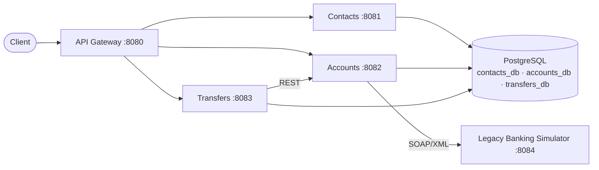

# TransferCore

> Backend simulator of banking operations — contacts, accounts & balances, idempotent transfers and a legacy SOAP integration — built with Java 21, Spring Boot 3.5 and a small microservice architecture.

**Status:** 🚧 Stage 1 of 7 — repository skeleton, architecture and local infrastructure.

All data is fictitious. Everything runs locally with Docker; no cloud account required.

## Architecture



More detail — domain model, transfer sequence and consistency trade-offs — in [docs/architecture.md](docs/architecture.md).
Decisions are recorded in [docs/adr](docs/adr).

## Tech stack

Java 21 · Spring Boot 3.5.16 · Spring Cloud Gateway (2025.0.3) · Spring Data JPA · Bean Validation · PostgreSQL 17 · Flyway ·
MapStruct 1.6 · JPA Specifications · Spring-WS / JAXB · JUnit 5 · Mockito · AssertJ · Testcontainers · Docker Compose · GitHub Actions

## Repository structure

```
transfercore/
├── api-gateway/                 # :8080  Spring Cloud Gateway (WebFlux)
├── contacts-service/            # :8081  contacts + contact accounts
├── accounts-service/            # :8082  bank accounts, balances, legacy SOAP client
├── transfers-service/           # :8083  idempotent transfers + history
├── legacy-banking-simulator/    # :8084  SOAP/XML legacy core
├── infra/postgres/init/         # creates one database + user per service
├── docs/                        # architecture, diagrams, ADRs
└── docker-compose.yml
```

## Running locally

Requirements: Docker (with Compose v2). Java/Maven are only needed to run services from an IDE.

```bash
docker compose up --build        # build and start everything
docker compose up -d postgres    # only the database (to run services from the IDE)
docker compose down              # stop
docker compose down -v           # stop and delete database data
```

Health checks: `http://localhost:{8080..8084}/actuator/health`

## Roadmap

- [x] Stage 1 — Monorepo, Maven, Docker Compose, PostgreSQL, architecture docs
- [ ] Stage 2 — Contacts Service
- [ ] Stage 3 — Accounts Service
- [ ] Stage 4 — Legacy Banking Simulator (SOAP)
- [ ] Stage 5 — Transfers Service
- [ ] Stage 6 — Gateway & end-to-end flow
- [ ] Stage 7 — CI, OpenAPI, final README
