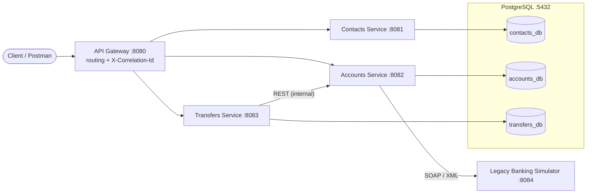
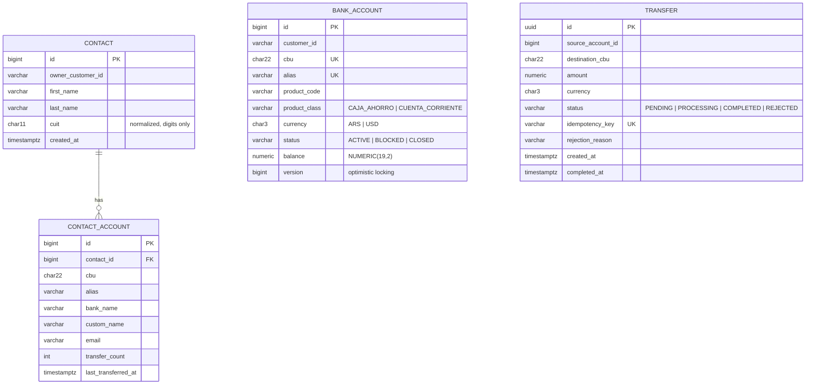

# Architecture

## Microservices



Communication rules:

- Clients only talk to the gateway. `/internal/**` endpoints are never routed by the gateway.
- **Accounts Service owns balances.** Transfers Service never touches `accounts_db`; it calls Accounts over REST.
- Debit and credit happen in **one local transaction inside Accounts Service** (`POST /internal/v1/accounts/transfer-postings`), keyed by `transferId` so a retried call is not applied twice.
- Accounts Service integrates with the legacy core over SOAP and adapts its XML responses to internal DTOs.

## Domain model



Each entity lives in a different database: `CONTACT`/`CONTACT_ACCOUNT` in `contacts_db`, `BANK_ACCOUNT` in `accounts_db`, `TRANSFER` in `transfers_db`. There are no cross-database foreign keys; `TRANSFER.source_account_id` is a reference by value.

## Transfer sequence

```mermaid
sequenceDiagram
    autonumber
    actor C as Client
    participant GW as API Gateway
    participant TS as Transfers Service
    participant TDB as transfers_db
    participant AS as Accounts Service
    participant ADB as accounts_db

    C->>GW: POST /v1/transfers (Idempotency-Key)
    GW->>TS: forward + X-Correlation-Id
    TS->>TDB: find by idempotency_key
    alt key already used
        TDB-->>TS: existing transfer
        TS-->>C: 200 original result (same body) / 422 (different body)
    else new request
        TS->>TDB: INSERT transfer (PROCESSING)
        TS->>AS: POST /internal/v1/accounts/transfer-postings (transferId)
        AS->>ADB: BEGIN; validate status/currency/balance;<br/>debit + credit (optimistic lock); COMMIT
        alt posting OK
            AS-->>TS: 200 posted
            TS->>TDB: UPDATE COMPLETED
            TS-->>C: 201 Created
        else business rule violated
            AS-->>TS: 422 reason
            TS->>TDB: UPDATE REJECTED (reason)
            TS-->>C: 422 Problem Detail
        end
    end
```

## Known consistency limitation

Steps 6-8 span two services and two databases, so they are **not** one atomic transaction.
If Transfers Service crashes after Accounts commits but before marking the transfer `COMPLETED`,
the transfer stays in `PROCESSING` while money has already moved. Because postings are idempotent
by `transferId`, a reconciliation job (or a retry) can safely re-ask Accounts and finish the transfer.
Production-grade alternatives: Transactional Outbox + messaging, or a Saga with compensations.
